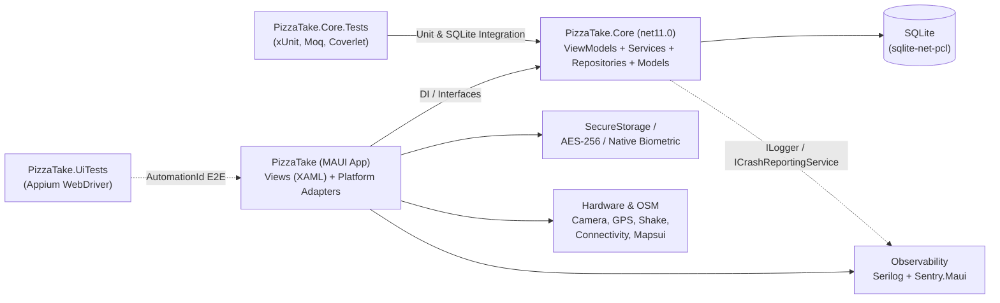
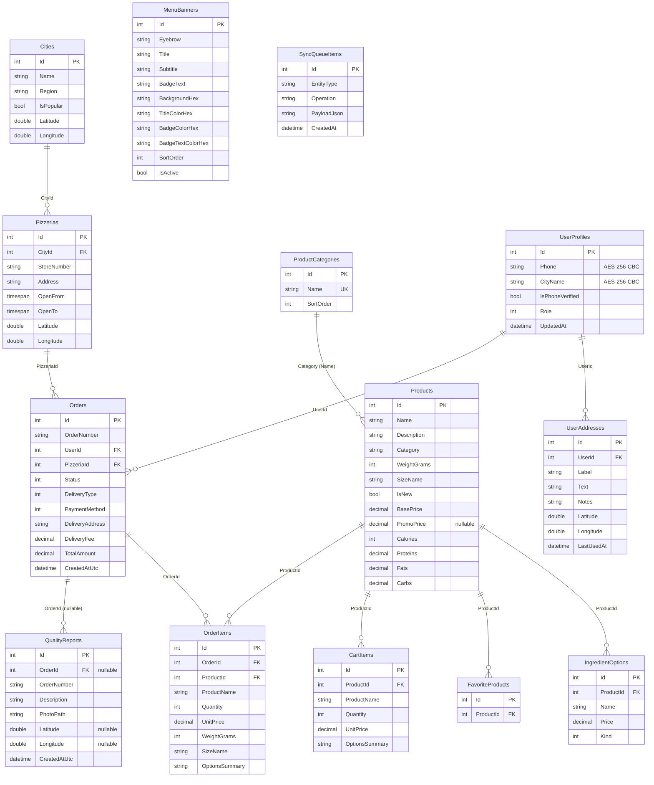

# PizzaTake — Мобільний застосунок замовлення та адміністрування доставки піци

**PizzaTake** — кросплатформний мобільний застосунок на **.NET MAUI (.NET 11, C#, MVVM)** для **Android (API 24+)** та **Windows (`windows10.0.19041.0`)**, що об’єднує клієнтський сценарій замовлення піци та панель адміністрування каталогу, категорій, банерів, замовлень і діагностики.

> Проєкт реалізовано у власній предметній області (служба доставки піци та адміністрування каталогу) зі збереженням повної чистої архітектури MVVM та всіх функціональних і нефункціональних вимог ЛР №1–9.

---

## 1. Функціональні можливості та сутності

### Основні можливості
- **Онбординг та геолокація:** вибір міста та піцерії з вбудованою інтерактивною картою **OpenStreetMap (`Mapsui.Maui`)**, визначення найближчих точок за формулою гаверсинусів (`GeoMath`) і відкриття маршруту на зовнішній карті (`Map.Default.OpenAsync`).
- **Каталог і замовлення:** фільтрація за категоріями та пошук у реальному часі, рекламні банери, відображення акційних цін зі старою перекресленою ціною та відсотком знижки $100 \cdot (\text{PromoPrice}/\text{BasePrice} - 1)$, детальна картка піци з КБЖВ та вибором добавок/виключень/замін, «Обране», кошик із крос-продажами (закуски/соуси), оформлення доставки або самовивозу («На виніс»), історія та трекінг статусу замовлень.
- **Офлайн-режим і синхронізація:** локальна БД **SQLite (`sqlite-net-pcl`)** з версіонованими міграціями (`PRAGMA user_version = 4`), транзакційним видаленням пов’язаних сутностей, чергою відкладеної синхронізації (`SyncQueueItems`), стратегією вирішення конфліктів **Last-Write-Wins (LWW)**, індикатором стану мережі та автосинхронізацією при запуску й відновленні зв’язку.
- **Безпека та RBAC:** OTP-автентифікація з ролями `Customer` і `Administrator`, дворівневий контроль доступу (UI Binding + перевірка всередині кожної адмін-команди та автоматичне закриття адмін-екранів у стеку `AppShell`), зберігання токенів/ролей виключно у `SecureStorage`, біометричне розблокування сесії через нативні платформні API (`AndroidX.Biometric.BiometricPrompt`, Windows Hello `UserConsentVerifier`, Apple `LAContext` у `MauiBiometricAuthService`), шифрування персональних даних у SQLite (**AES-256-CBC** із випадковим IV), **SSL Certificate Pinning** (SHA-256) у `HttpApiClient` із можливістю діагностичної перевірки на `LogsPage`, `android:allowBackup="false"`.
- **Апаратні можливості:** перевірка підтримки пристроєм та запит дозволів Android/Windows із поясненням (`ShouldShowRationale`), фото-акти якості (`QualityReport`) із камери або галереї (`AppDataDirectory/photos`), GPS-координати, відкриття акту якості за струшуванням пристрою (`IShakeSensorService` із зупинкою у фоновому режимі), обробка Deep Links (`pizzaapp://pizza?id=1`, `pizzaapp://pizza/1`, `pizzaapp://order?id=1`, `pizzaapp://order/1`).
- **Спостережуваність (Observability):** структуроване логування **Serilog** (`Debug` + ротація файлів на 7 днів), підключене перед **Sentry.Maui** (`SendDefaultPii = false`, `MinimumBreadcrumbLevel = Information`, `MinimumEventLevel = None`), глобальне перехоплення необроблених винятків (`AppDomain`, `TaskScheduler`, `AndroidEnvironment`, `WinUI.UnhandledException`), вбудований переглядач локальних логів `LogsPage` для адміністратора (фільтри `Усі` / `Debug` / `Information` / `Warning` / `Error` / `Fatal`, тест `UnobservedTaskException`, тест SSL Pinning, тест крашу Sentry) та надсилання звітів про помилки з останніми 30 рядками логу.

### Доменні сутності (`PizzaTake.Core/Models`)
| Категорія | Сутності |
|---|---|
| Каталог та промо | `Product`, `ProductCategory`, `IngredientOption`, `MenuBanner`, `FavoriteProduct` |
| Локації | `City`, `Pizzeria` |
| Користувач і безпека | `UserProfile` *(AES-256-CBC)*, `UserAddress`, `UserRole` |
| Кошик та замовлення | `CartItem`, `Order`, `OrderItem`, `DeliveryType`, `OrderStatus`, `PaymentMethod`, `OptionKind` |
| Якість, синк і логи | `QualityReport`, `SyncQueueItem`, `LogEntry` *(in-memory DTO)* |

---

## 2. Архітектура рішення та карта навігації

Рішення `PizzaTake/PizzaTake.slnx` побудоване за принципом чистого розділення платформно-незалежного ядра та MAUI-оболонки:

```text
PizzaTake/
├── PizzaTake.slnx
├── PizzaTake.Core/                  # Class Library (net11.0, 0 посилань на Microsoft.Maui.*)
│   ├── Models/                      # 16 файлів: SQLite-сутності, DTO, Enums
│   ├── Repositories/                # 14 файлів: інтерфейси I*Repository та SQLite-реалізації
│   ├── Services/                    # 21 файл: контракти платформних/апаратних сервісів, SqliteDatabase,
│   │                                #          AuthService, SessionService, AesEncryptionService,
│   │                                #          HttpApiClient (SSL Pinning), SyncService, GeoMath
│   └── ViewModels/                  # 20 файлів: BaseViewModel, ConnectivityBannerViewModel,
│                                    #            FormFeedbackViewModel та всі ViewModel екранів
├── PizzaTake/                       # .NET MAUI App (net11.0-android + net11.0-windows10.0.19041.0)
│   ├── Views/                       # 19 сторінок XAML + 19 файлів code-behind (0 бізнес-логіки)
│   ├── Behaviors/                   # 1 файл: PhoneInputBehavior (форматування телефону UA + курсор)
│   ├── Services/Platform/           # 18 платформних адаптерів (Shell, Dialog, SecureStorage,
│   │                                #   Biometric, Camera, GPS, Shake, Connectivity, OsmMapRenderer,
│   │                                #   SerilogLogReader, SentryCrashReporting, GlobalExceptionHandler)
│   ├── Converters/                  # 4 XAML-конвертери (CategoryChip, HexColor, LogFilterChip, OrderProgress)
│   ├── Resources/Styles/            # Світла/темна тема, типографіка, перевикористовувані стилі форм
│   ├── Platforms/                   # Android (AndroidManifest, MainActivity, MainApplication, ShellRenderer)
│   │                                #   та Windows (App.xaml.cs із WinUI.UnhandledException)
│   └── MauiProgram.cs               # DI-контейнер, Serilog -> Sentry.Maui, SkiaSharp/Mapsui
├── PizzaTake.Core.Tests/            # xUnit + Moq + FluentAssertions + coverlet
│   ├── Unit/                        # 13 тестових класів (Unit: [Fact] + [Theory])
│   └── Integration/                 # 3 інтеграційних класи на реальній тимчасовій SQLite БД
└── PizzaTake.UiTests/               # xUnit + Appium.WebDriver (2 E2E-сценарії за AutomationId)
```



### Карта екранів та маршрутів Shell (`AppShell.xaml.cs`)
| Тип маршруту | Маршрут Shell | Сторінка (`Views/`) | ViewModel (`PizzaTake.Core`) | Призначення |
|---|---|---|---|---|
| Коренева вкладка *(Welcome TabBar)* | `///welcome-start` | `WelcomePage` | `WelcomeViewModel` | Стартовий онбординг при першому запуску |
| Вкладка *(Main TabBar)* | `///menu` | `MenuPage` | `MenuViewModel` | Каталог піц, банери, пошук, адмін-панель |
| Вкладка *(Main TabBar)* | `///favorites` | `FavoritesPage` | `FavoritesViewModel` | Збережені обрані товари |
| Вкладка *(Main TabBar)* | `///cart` | `CartPage` | `CartViewModel` | Кошик, кількість, крос-продажі |
| Вкладка *(Main TabBar)* | `///history` | `OrderHistoryPage` | `OrderHistoryViewModel` | Історія замовлень (захищена при блокуванні сесії) |
| Вкладка *(Main TabBar)* | `///settings` | `SettingsPage` | `SettingsViewModel` | Профіль, адреси, тема, синк, сесія, карта/якість/логи |
| Зареєстрований маршрут | `welcome` | `WelcomePage` | `WelcomeViewModel` | Повернення на привітальний екран |
| Зареєстрований маршрут | `cities` | `CitySelectionPage` | `CitySelectionViewModel` | Вибір міста та GPS-пошук найближчого |
| Зареєстрований маршрут | `pizzerias` | `PizzeriaSelectionPage` | `PizzeriaSelectionViewModel` | Вибір піцерії з вбудованою картою OSM |
| Зареєстрований маршрут | `pizzadetail` | `PizzaDetailPage` | `PizzaDetailViewModel` | Картка товару, КБЖВ, опції (+ Deep Link) |
| Зареєстрований маршрут | `auth` | `AuthPage` | `AuthViewModel` | OTP-вхід та біометричне розблокування |
| Зареєстрований маршрут | `checkout` | `CheckoutPage` | `CheckoutViewModel` | Оформлення доставки / самовивозу (офлайн-підтримка) |
| Зареєстрований маршрут | `orderdetail` | `OrderDetailPage` | `OrderDetailViewModel` | Деталі й трекінг замовлення (+ Deep Link, адмін-статус) |
| Зареєстрований маршрут | `addressedit` | `AddressEditPage` | `AddressEditViewModel` | Створення / редагування адреси + GPS-координати |
| Зареєстрований маршрут | `qualityreport` | `QualityReportPage` | `QualityReportViewModel` | Акт контролю якості (камера, галерея, GPS) |
| Зареєстрований маршрут | `pizzeriasmap` | `PizzeriasMapPage` | `PizzeriasMapViewModel` | Повноекранна карта OSM (`Mapsui`) + зовнішня карта |
| Зареєстрований маршрут *(Admin)* | `adminproductedit` | `AdminProductEditPage` | `AdminProductEditViewModel` | CRUD товару, акційної ціни, КБЖВ та добавок |
| Зареєстрований маршрут *(Admin)* | `admincategories` | `AdminCategoriesPage` | `AdminCategoriesViewModel` | CRUD та сортування категорій каталогу |
| Зареєстрований маршрут *(Admin)* | `adminbanners` | `AdminBannersPage` | `AdminBannersViewModel` | CRUD та активація промо-банерів |
| Зареєстрований маршрут *(Admin)* | `logs` | `LogsPage` | `LogsViewModel` | Переглядач логів Serilog, SSL Pinning та Sentry-діагностика |

### Архітектурні принципи
- **`0` посилань на `Microsoft.Maui.*`** та статичні MAUI API у `PizzaTake.Core`.
- **`0` бізнес-логіки**, звернень до репозиторіїв, `Clicked`-навігації або `Shell.Current` у code-behind усіх 19 сторінок `Views/` *(6 ранніх сторінок мають іменування `*.cs`, решта 13 — `*.xaml.cs`; навігація, у т.ч. по акселерометру, проходить виключно через `IMainThreadDispatcher` → команду ViewModel → `INavigationService`)*.
- **`0` викликів `Debug.WriteLine`** — усе логування уніфіковано через `ILogger<T>` (Serilog).
- **Дворівневий RBAC** на всіх адмін-екранах і командах (`IsAdmin`/`CanShowAdminPanel` Binding + `BaseViewModel.RequireAdminAsync` + автозакриття адмін-сторінок у `AppShell`).
- **Жоден відкритий секрет** (Sentry DSN, keystore) або службовий каталог `.idea/` не зберігається в репозиторії.

---

## 3. Схема бази даних (SQLite ER-діаграма, шифрування та міграції)



### Шифрування даних у стані спокою та цілісність
- У таблиці **`UserProfiles`** поля `Phone` та `CityName` прозоро шифруються в `UserProfileRepository` через `AesEncryptionService` (**AES-256-CBC (PKCS7)** з унікальним 16-байтним IV перед шифротекстом і збереженням у форматі Base64: `Base64(IV || ciphertext)`). Ключ `pizzatake_aes_key` зберігається виключно у `SecureStorage` (`ISecureStoreService`).
- У `SyncQueueItems` для змін профілю передається ідентифікатор `CityId` без відкритого тексту персональних даних (`Phone`/`CityName`).
- Токен сесії (`pizzatake_auth_token`), роль (`pizzatake_user_role`), телефон (`pizzatake_user_phone`) та прапорець блокування (`pizzatake_session_locked`) зберігаються виключно у `SecureStorage`, а не у відкритих `Preferences`.
- Видалення товару (`ProductRepository.DeleteAsync`) виконується в атомарній SQLite-транзакції (`RunInTransactionAsync`), очищаючи пов’язані `IngredientOptions`, `FavoriteProducts`, `CartItems` та `Products`.

### Міграції схеми (`SqliteDatabase.ApplyMigrationsAsync`, `LatestSchemaVersion = 4`)
| Версія `PRAGMA user_version` | Зміни схеми |
|---|---|
| `0 → 1` | Створення 11 базових таблиць (`Cities`, `Pizzerias`, `Products`, `IngredientOptions`, `FavoriteProducts`, `UserProfiles`, `UserAddresses`, `CartItems`, `Orders`, `OrderItems`, `SyncQueueItems`). |
| `1 → 2` | `ALTER TABLE UserAddresses`: додавання колонок `Notes`, `Latitude`, `Longitude`. |
| `2 → 3` | Створення таблиці `QualityReports`; додавання колонки `Role` (`INTEGER NOT NULL DEFAULT 0`) до `UserProfiles`. |
| `3 → 4` | Створення таблиць `ProductCategories` та `MenuBanners` (`MigrateToV4Async`) із початковим наповненням при першому запуску. |

---

## 4. Матриця доступу (RBAC) та тестові облікові записи

### Тестові облікові записи
| Роль | Телефон | OTP-код | Опис доступу |
|---|---|:-:|---|
| **`UserRole.Administrator`** | `+380990000001` *(або `0990000001`)* | `1234` *(будь-які 4 цифри в dev-симуляції)* | Повний доступ клієнта + керування каталогом, категоріями, банерами, статусами замовлень та журналом логів |
| **`UserRole.Customer`** | `+380991112233` *(будь-який інший валідний номер UA)* | `1234` | Стандартний клієнтський інтерфейс; усі адмін-кнопки приховані, а прямі виклики адмін-команд заблоковані |

### Повна матриця доступу «Роль — Екран — Дія» (усі 19 екранів)
| Екран | Дія | `Customer` | `Administrator` | Точка перевірки (Рівень 1 UI + Рівень 2 Команда / Shell) |
|---|---|:-:|:-:|---|
| `WelcomePage` | Стартовий онбординг, перехід до вибору міста | ✅ | ✅ | — |
| `CitySelectionPage` | Пошук / вибір міста, GPS-автовизначення | ✅ | ✅ | — |
| `PizzeriaSelectionPage` | Вибір піцерії, вбудована карта OSM | ✅ | ✅ | — |
| `PizzeriasMapPage` | Повноекранна карта OSM (`Mapsui`), маркери, зовнішня карта | ✅ | ✅ | — |
| `MenuPage` | Перегляд каталогу, банерів, пошук, додавання в кошик | ✅ | ✅ | — |
| `MenuPage` | «+ Товар», редагування товару (`✎`) | ❌ | ✅ | `IsAdmin` + `OpenAdminProductCommand` (`RequireAdminAsync`) |
| `MenuPage` | Керування категоріями / банерами меню | ❌ | ✅ | `IsAdmin` + `OpenAdminCategoriesCommand` / `OpenAdminBannersCommand` |
| `PizzaDetailPage` | Перегляд КБЖВ, вибір опцій, «Обране», додавання в кошик | ✅ | ✅ | — |
| `FavoritesPage` | Перегляд та керування обраними товарами | ✅ | ✅ | — |
| `CartPage` | Зміна кількості, видалення, крос-продажі, перехід до оформлення | ✅ | ✅ | — |
| `AuthPage` | Вхід за телефоном (OTP), біометричне розблокування сесії | ✅ | ✅ | — |
| `CheckoutPage` | Оформлення доставки/самовивозу, збереження чернетки, офлайн-черга | ✅ | ✅ | Потребує підтвердженої авторизації (`AuthService.IsAuthenticated`) |
| `OrderHistoryPage` | Перегляд історії замовлень, перехід у деталі | ✅ | ✅ | При заблокованій сесії дані приховані (`IsSessionLocked`) |
| `OrderDetailPage` | Перегляд замовлення, повтор у кошик, фото-звернення | ✅ | ✅ | При заблокованій сесії стек автоматично закривається (`AppShell`) |
| `OrderDetailPage` | Зміна статусу замовлення / видалення замовлення | ❌ | ✅ | `CanShowAdminPanel` + `AdvanceOrderStatusCommand`, `DeleteOrderCommand` |
| `SettingsPage` | Профіль, місто, адреси, тема, синк, акт якості, блокування сесії | ✅ | ✅ | При `IsSessionLocked` адреси/телефон приховані, редагування заблоковане |
| `SettingsPage` | Перехід у «Журнал логів» (`LogsPage`) | ❌ | ✅ | `IsAdmin` + `OpenLogsCommand` (`RequireAdminAsync`) |
| `AddressEditPage` | Створення / редагування / видалення адреси доставки + GPS | ✅ | ✅ | — |
| `QualityReportPage` | Створення / видалення фото-акту якості (камера/галерея + GPS) | ✅ | ✅ | — |
| `AdminProductEditPage` | Створення / редагування / видалення товару, акційної ціни, КБЖВ та добавок | ❌ | ✅ | `IsAdmin` + вхідна перевірка `EnsureAdminAccessAndLoadAsync`, `SaveProductCommand`, `DeleteProductCommand`, `AddOptionCommand`, `DeleteOptionCommand` + `AppShell` |
| `AdminCategoriesPage` | Створення / перейменування / порядок / видалення категорій | ❌ | ✅ | `IsAdmin` + `LoadCommand`, `SaveCategoryCommand`, `DeleteCategoryCommand`, `MoveUpCommand`, `MoveDownCommand` + `AppShell` |
| `AdminBannersPage` | Створення / редагування / активація / видалення банерів | ❌ | ✅ | `IsAdmin` + `LoadCommand`, `SaveBannerCommand`, `ToggleActiveCommand`, `DeleteBannerCommand` + `AppShell` |
| `LogsPage` | Перегляд/фільтрація локальних логів (`Debug`..`Fatal`), тест Task/SSL Pinning/Sentry крашу | ❌ | ✅ | `IsAdmin` + `EnsureAdminAccessAsync` у всіх командах (`LoadLogsCommand`, `SelectLevelCommand`, `SendBugReportCommand`, `TestTaskExceptionCommand`, `TestSslPinningCommand`, `TestSentryCrashCommand`) + `AppShell` |

> При спробі викликати захищену команду під роллю `Customer` спрацьовує `BaseViewModel.RequireAdminAsync` (або `LogsViewModel.EnsureAdminAccessAsync`): записується попередження `LogWarning("Access denied for role {Role} on {Command}", ...)`, відображається діалог `«Доступ заборонено»`, а зміна даних не виконується.

---

## 5. Таблиця відповідності вимогам ЛР №1 – ЛР №8

| Лабораторна робота | Ключові вимоги | Реалізація у `PizzaTake` (файли та символи) |
|---|---|---|
| **ЛР №1 — MVVM та базовий UI** | Патерн MVVM (`INotifyPropertyChanged`), двосторонній data binding, валідація форм, конвертери, ресурси/стилі, адаптивна верстка | `PizzaTake.Core/ViewModels/{BaseViewModel,FormFeedbackViewModel,MenuViewModel,PizzaDetailViewModel,AddressEditViewModel,CheckoutViewModel}.cs`, `PizzaTake/Converters/{CategoryChipConverter,HexColorConverter,LogFilterChipConverter,OrderProgressConverter}.cs`, `PizzaTake/Behaviors/PhoneInputBehavior.cs`, `PizzaTake/Resources/Styles/{Colors,Styles}.xaml` |
| **ЛР №2 — Команди та навігація** | `IRelayCommand`/`IAsyncRelayCommand` (`CanExecute`), `Shell` навігація з передачею параметрів (`IQueryAttributable`), DI-реєстрація, чистий code-behind | `PizzaTake/AppShell.xaml.cs`, `PizzaTake/Services/Platform/{ShellNavigationService,MauiDialogService}.cs`, `PizzaTake/MauiProgram.cs`, `Views/*` (0 `Shell.Current`, 0 бізнес-логіки) |
| **ЛР №3 — Локальна БД SQLite** | `sqlite-net-pcl`, CRUD-репозиторії, зв’язки 1:N, версіоновані міграції (`PRAGMA user_version`), транзакції, обробка помилок | `PizzaTake.Core/Services/SqliteDatabase.cs` (`v0→v4`), `PizzaTake.Core/Repositories/{SqliteRepositoryBase,CatalogRepositories,CartRepository,OrderRepository,AddressRepository,UserProfileRepository,QualityReportRepository,SyncQueueRepository}.cs` |
| **ЛР №4 — Мережа, офлайн, стан, теми, Deep Links** | `Preferences`/`SecureStorage`, AES-256-CBC шифрування, `HttpApiClient`, офлайн-черга `SyncQueue` + LWW-синхронізація, чернетки і життєвий цикл, 3 теми, Deep Links | `PizzaTake.Core/Services/{AesEncryptionService,HttpApiClient,SyncService,AppStateService}.cs`, `PizzaTake/App.xaml.cs`, `PizzaTake/Platforms/Android/MainActivity.cs` (`pizzaapp://pizza`, `pizzaapp://order`), `PizzaTake/Views/SettingsPage.xaml` |
| **ЛР №5 — Логування та краш-репортинг** | Serilog (Debug + ротація файлів на 7 днів), `ILogger<T>` (0 `Debug.WriteLine`), глобальні обробники винятків, Sentry.Maui (`SendDefaultPii = false`), `LogsPage`, баг-репорт з логами | `PizzaTake/MauiProgram.cs`, `PizzaTake/Services/Platform/{GlobalExceptionHandler,SentryCrashReportingService,SerilogLogReaderService}.cs`, `PizzaTake/Platforms/{Android/MainApplication.cs,Windows/App.xaml.cs}`, `PizzaTake.Core/Services/BugReportService.cs`, `PizzaTake.Core/ViewModels/LogsViewModel.cs`, `PizzaTake/Views/LogsPage.xaml` |
| **ЛР №6 — Безпека, RBAC, біометрія, SSL Pinning** | `UserRole`, `ISessionService`, `SecureStorage`, дворівневий RBAC, нативна біометрія + блокування сесії, SSL Certificate Pinning (SHA-256), `allowBackup="false"`, адмін-екрани | `PizzaTake.Core/Models/Enums.cs`, `PizzaTake.Core/Services/{SessionService,AuthService,HttpApiClient}.cs`, `PizzaTake/Services/Platform/{MauiSecureStoreService,MauiBiometricAuthService}.cs`, `PizzaTake.Core/ViewModels/{BaseViewModel,AdminProductEditViewModel,AdminCategoriesViewModel,AdminBannersViewModel}.cs`, `PizzaTake/Platforms/Android/AndroidManifest.xml` |
| **ЛР №7 — Апаратні функції та карти** | Дозволи Android (`ShouldShowRationale`, `<uses-feature>`, `<queries>`), камера/галерея (`QualityReport`), GPS + fallback, OpenStreetMap (`Mapsui.Maui` + зовнішня карта), акселерометр (Shake), стан мережі (`IConnectivityService`) | `PizzaTake/Platforms/Android/AndroidManifest.xml`, `PizzaTake.Core/Models/QualityReport.cs`, `PizzaTake.Core/Services/{HardwareContracts,GeoMath}.cs`, `PizzaTake/Services/Platform/{MauiPermissionService,MauiMediaService,MauiLocationService,MauiMapLauncherService,MauiShakeSensorService,MauiConnectivityService,OsmMapRenderer}.cs`, `PizzaTake/Views/{QualityReportPage,PizzeriasMapPage,PizzeriaSelectionPage}.*` |
| **ЛР №8 — Тестування та CI/CD** | Чисте ядро `PizzaTake.Core` (0 `Microsoft.Maui.*`), Unit (`[Fact]`/`[Theory]`, `Moq`, `FluentAssertions`) + SQLite Integration тести (`IAsyncLifetime`), покриття ViewModel >70%, Appium UI-тести (`AutomationId`), GitHub Actions CI | `PizzaTake.Core/PizzaTake.Core.csproj`, `PizzaTake.Core.Tests/{Unit,Integration}/*.cs` (100 тестів), `PizzaTake.UiTests/{AppiumDriverFixture,PizzaTakeUiTests}.cs`, `.github/workflows/ci.yml` |

---

## 6. Інструкція зі збірки, тестування та налаштування

### Передумови
- **.NET 11 SDK** (`11.0.x`) із MAUI workloads (`dotnet workload install maui-android maui-windows`)
- **Java 21 (Temurin)** та **Android SDK (API 24+ / API 36)** для збірки та емулятора Android
- *(Опційно)* `dotnet-reportgenerator-globaltool` для HTML-звіту покриття
- *(Опційно)* **Appium 2** + драйвер `uiautomator2` для E2E UI-тестів

### 6.1. Збірка застосунку
```bash
# Windows (Debug)
dotnet build PizzaTake/PizzaTake/PizzaTake.csproj -f net11.0-windows10.0.19041.0 -c Debug

# Android Release APK
dotnet restore PizzaTake/PizzaTake/PizzaTake.csproj -p:Configuration=Release --force
dotnet build PizzaTake/PizzaTake/PizzaTake.csproj --no-restore -f net11.0-android -c Release -p:PublishReadyToRun=false -p:AndroidPackageFormat=apk
```
Зібраний APK знаходиться у `PizzaTake/PizzaTake/bin/Release/net11.0-android/` (або в артефакті `pizzatake-android-apk` у GitHub Actions).

### 6.2. Запуск модульних та інтеграційних тестів і генерація HTML-покриття
```bash
# Запуск усіх 100 модульних та інтеграційних тестів (Unit + SQLite Integration) зі збором покриття Cobertura
dotnet test PizzaTake/PizzaTake.Core.Tests/PizzaTake.Core.Tests.csproj \
  --configuration Release \
  --collect:"XPlat Code Coverage" \
  --results-directory ./TestResults

# Генерація HTML-звіту покриття
# Поріг ViewModel >= 60%; поточні показники: 70.35% загалом по PizzaTake.Core (74.00% по ViewModels, 75.3% методів)
dotnet tool install -g dotnet-reportgenerator-globaltool
reportgenerator \
  -reports:"./TestResults/**/coverage.cobertura.xml" \
  -targetdir:"./CoverageReport" \
  -reporttypes:Html
```
Відкрийте `./CoverageReport/index.html` у браузері для перегляду детального покриття по класах.

### 6.3. Запуск Appium UI-тестів (`PizzaTake.UiTests`)
1. Запустіть Android-емулятор і встановіть APK (`adb install -r ...`).
2. Запустіть сервер Appium 2 (`appium`).
3. Виконайте E2E-тести:
```bash
dotnet test PizzaTake/PizzaTake.UiTests/PizzaTake.UiTests.csproj -c Release
```
Сценарії використовують стабільні `AutomationId` (`AuthPhoneEntry`, `AuthPolicyCheckBox`, `AuthRequestSmsButton`, `AuthOtpEntry`, `AuthVerifySmsButton`, `MenuSearchBar`, `SettingsAddAddressButton`, `AddressLabelEntry`, `AddressTextEntry`, `AddressNotesEntry`, `AddressSaveButton`, `LogsFilterDebugButton`, `LogsTestSslPinningButton`).

### 6.4. Налаштування Sentry DSN
Секретний DSN **не зберігається** у вихідному коді (`MauiProgram.ResolveSentryDsn()`). Його можна передати одним із трьох способів (у порядку пріоритету):
1. **Змінна середовища:** `SENTRY_DSN="https://<key>@o<org>.ingest.sentry.io/<project>"` (рекомендовано для CI/CD і локального запуску).
2. **MSBuild-властивість `SentryDsn`** під час збірки (`AssemblyMetadata("SentryDsn", ...)`):
   ```bash
   dotnet build PizzaTake/PizzaTake/PizzaTake.csproj -f net11.0-android -c Release -p:PublishReadyToRun=false -p:AndroidPackageFormat=apk -p:SentryDsn="https://<key>@o<org>.ingest.sentry.io/<project>"
   ```
3. **Локальні налаштування пристрою (`Preferences`):** ключ `diagnostics.sentry_dsn`.

У конфігурації примусово встановлено `options.SendDefaultPii = false` для захисту персональних даних користувачів.

### 6.5. Тестування Deep Links на Android
Підтримуються обидва формати маршрутів (query-параметр `?id=` та path-сегмент `/{id}`):
```bash
# Відкрити картку піци з Id=1
adb shell am start -W -a android.intent.action.VIEW -d "pizzaapp://pizza?id=1" com.companyname.pizzatake
adb shell am start -W -a android.intent.action.VIEW -d "pizzaapp://pizza/1" com.companyname.pizzatake

# Відкрити деталі замовлення з Id=1
adb shell am start -W -a android.intent.action.VIEW -d "pizzaapp://order?id=1" com.companyname.pizzatake
adb shell am start -W -a android.intent.action.VIEW -d "pizzaapp://order/1" com.companyname.pizzatake
```

### 6.6. CI/CD (GitHub Actions)
Конвеєр [`.github/workflows/ci.yml`](.github/workflows/ci.yml) запускається автоматично на кожен `push` та `pull_request` у `master`, `lab*`, `feature/*`:
1. **`test-core` (`ubuntu-latest`)** — збірка та прогін `PizzaTake.Core.Tests` у `Release`, публікація артефакту `code-coverage-report` (`coverage.cobertura.xml` + `.trx`).
2. **`build-android` (`needs: test-core`)** — встановлення `maui-android` та Android SDK, збірка Release `.apk` і публікація артефакту `pizzatake-android-apk`.
