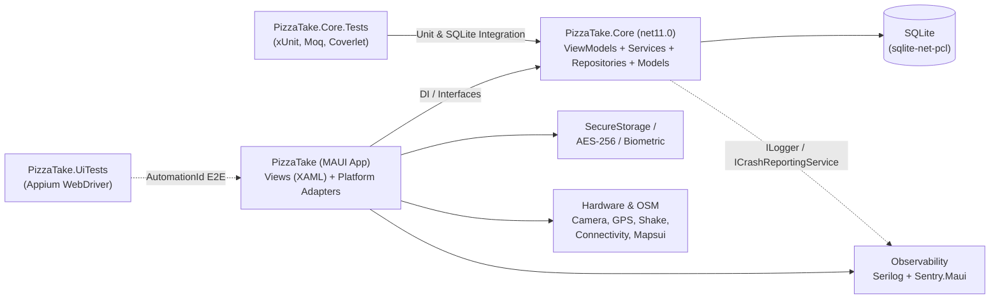

# PizzaTake — Мобільний застосунок замовлення та адміністрування доставки піци

**PizzaTake** — кросплатформний мобільний застосунок на **.NET MAUI (.NET 11, C#, MVVM)** для **Android (API 24+)** та **Windows (`windows10.0.19041.0`)**, що об’єднує клієнтський сценарій замовлення піци та панель адміністрування каталогу, замовлень, категорій, банерів і діагностики.

---

## 1. Функціональні можливості та сутності

### Основні можливості
- **Онбординг та геолокація:** вибір міста та піцерії з вбудованою інтерактивною картою **OpenStreetMap (`Mapsui.Maui`)**, визначення найближчих точок за формулою гаверсинусів (`GeoMath`) і відкриття маршруту на зовнішній карті (`Map.Default.OpenAsync`).
- **Каталог і замовлення:** фільтрація за категоріями та пошук у реальному часі, рекламні банери, відображення акційних цін зі старою перекресленою ціною та відсотком знижки $100 \cdot (\text{PromoPrice}/\text{BasePrice} - 1)$, детальна картка піци з КБЖВ та вибором добавок/виключень/замін, «Обране», кошик із крос-продажами (закуски/соуси), оформлення доставки або самовивозу («На виніс»), історія та трекінг статусу замовлень.
- **Офлайн-режим і синхронізація:** локальна БД **SQLite (`sqlite-net-pcl`)** з версіонованими міграціями (`PRAGMA user_version`), черга відкладеної синхронізації (`SyncQueueItems`), стратегія вирішення конфліктів **Last-Write-Wins (LWW)**, індикатор стану мережі та автосинхронізація при відновленні зв’язку.
- **Безпека та RBAC:** OTP-автентифікація з ролями `Customer` і `Administrator`, дворівневий контроль доступу (UI Binding + перевірка всередині кожної адмін-команди), зберігання токенів/ролей виключно у `SecureStorage`, біометричне розблокування сесії (`Plugin.Maui.Biometric`), шифрування персональних даних у SQLite (**AES-256-CBC** із випадковим IV), **SSL Certificate Pinning** (SHA-256) у `HttpApiClient`.
- **Апаратні можливості:** запит дозволів Android/Windows із поясненням (`ShouldShowRationale`), фото-акти якості (`QualityReport`) із камери або галереї (`AppDataDirectory/photos`), GPS-координати, відкриття акту якості за струшуванням пристрою (`IShakeSensorService`), обробка Deep Links (`pizzaapp://pizza?id=...`, `pizzaapp://order?id=...`).
- **Спостережуваність (Observability):** структуроване логування **Serilog** (Debug + ротація файлів на 7 днів), глобальне перехоплення необроблених винятків (`AppDomain`, `TaskScheduler`, `AndroidEnvironment`), інтеграція **Sentry.Maui** (`SendDefaultPii = false`), вбудований переглядач локальних логів `LogsPage` для адміністратора та надсилання звітів про помилки з останніми 30 рядками логу.

### Доменні сутності (`PizzaTake.Core/Models`)
| Категорія | Сутності |
|---|---|
| Каталог та промо | `Product`, `ProductCategory`, `IngredientOption`, `MenuBanner`, `FavoriteProduct` |
| Локації | `City`, `Pizzeria` |
| Користувач і безпека | `UserProfile` *(AES-шифрування)*, `UserAddress`, `UserRole` |
| Кошик та замовлення | `CartItem`, `Order`, `OrderItem`, `DeliveryType`, `OrderStatus`, `PaymentMethod`, `OptionKind` |
| Якість, синк і логи | `QualityReport`, `SyncQueueItem`, `LogEntry` *(in-memory DTO)* |

---

## 2. Архітектура рішення

Рішення `PizzaTake/PizzaTake.slnx` побудоване за принципом чистого розділення платформно-незалежного ядра та MAUI-оболонки:

```text
PizzaTake/
├── PizzaTake.slnx
├── PizzaTake.Core/                  # Class Library (net11.0, 0 посилань на Microsoft.Maui.*)
│   ├── Models/                      # 16 файлів: SQLite-сутності, DTO, Enums
│   ├── Repositories/                # 14 файлів: інтерфейси I*Repository та SQLite-реалізації
│   ├── Services/                    # 21 файл: контракти платформних/апаратних сервісів, SqliteDatabase,
│   │                                #          AuthService, SessionService, AesEncryptionService,
│   │                                #          HttpApiClient (SSL Pinning), SyncService, GeoMath
│   └── ViewModels/                  # 20 файлів: BaseViewModel, ConnectivityBannerViewModel,
│                                    #            FormFeedbackViewModel та всі ViewModel екранів
├── PizzaTake/                       # .NET MAUI App (net11.0-android + net11.0-windows10.0.19041.0)
│   ├── Views/                       # 19 сторінок XAML + чистий code-behind (0 бізнес-логіки)
│   ├── Services/Platform/           # 18 платформних адаптерів (Shell, Dialog, SecureStorage,
│   │                                #   Biometric, Camera, GPS, Shake, Connectivity, OsmMapRenderer,
│   │                                #   SerilogLogReader, SentryCrashReporting, GlobalExceptionHandler)
│   ├── Converters/                  # 4 XAML-конвертери (CategoryChip, HexColor, LogFilterChip, OrderProgress)
│   ├── Resources/Styles/            # Світла/темна тема, типографіка, перевикористовувані стилі форм
│   ├── Platforms/                   # AndroidManifest.xml, MainActivity (Deep Links), MainApplication (Crash)
│   └── MauiProgram.cs               # DI-контейнер, Serilog, Sentry.Maui, SkiaSharp/Mapsui
├── PizzaTake.Core.Tests/            # xUnit + Moq + FluentAssertions + coverlet
│   ├── Unit/                        # 13 тестових класів (Unit: [Fact] + [Theory])
│   └── Integration/                 # 3 інтеграційних класи на реальній тимчасовій SQLite БД
└── PizzaTake.UiTests/               # xUnit + Appium.WebDriver (2 E2E-сценарії за AutomationId)
```



### Архітектурні принципи
- **`0` посилань на `Microsoft.Maui.*`** та статичні MAUI API у `PizzaTake.Core`.
- **`0` бізнес-логіки**, звернень до репозиторіїв, `Clicked`-навігації або `Shell.Current` у `Views/*.xaml.cs` (включно з обробниками акселерометра — навігація йде через `IMainThreadDispatcher` → команда ViewModel → `INavigationService`).
- **`0` викликів `Debug.WriteLine`** — усе логування уніфіковано через `ILogger<T>` (Serilog).
- **Дворівневий RBAC** на всіх адмін-екранах і командах (`IsAdmin` Binding + `BaseViewModel.RequireAdminAsync`).
- **Жоден відкритий секрет** (Sentry DSN, keystore) або службовий каталог `.idea/` не зберігається в репозиторії.

---

## 3. Схема бази даних (SQLite ER-діаграма, шифрування та міграції)


### Шифрування даних у стані спокою
- У таблиці **`UserProfiles`** поля `Phone` та `CityName` прозоро шифруються в `UserProfileRepository` через `AesEncryptionService` (**AES-256-CBC (PKCS7)** з унікальним 16-байтним IV перед шифротекстом і збереженням у форматі Base64: `Base64(IV || ciphertext)`). Ключ `pizzatake_aes_key` зберігається виключно у `SecureStorage` (`ISecureStoreService`).
- Токен сесії (`auth.token`), роль (`auth.role`), телефон (`auth.phone`) та прапорець блокування (`auth.locked`) також зберігаються виключно у `SecureStorage`, а не у відкритих `Preferences`.

### Міграції схеми (`SqliteDatabase.ApplyMigrationsAsync`)
| Версія `PRAGMA user_version` | Зміни схеми |
|---|---|
| `0 → 1` | Створення 11 базових таблиць (`Cities`, `Pizzerias`, `Products`, `IngredientOptions`, `FavoriteProducts`, `UserProfiles`, `UserAddresses`, `CartItems`, `Orders`, `OrderItems`, `SyncQueueItems`). |
| `1 → 2` | `ALTER TABLE UserAddresses`: додавання колонок `Notes`, `Latitude`, `Longitude`. |
| `2 → 3` | Створення таблиці `QualityReports`; додавання колонки `Role` (`INTEGER NOT NULL DEFAULT 0`) до `UserProfiles`. |
| Розширення каталогу | Ідемпотентне створення таблиць `ProductCategories` та `MenuBanners` із початковим наповненням при першому запуску. |

---

## 4. Матриця доступу (RBAC) та тестові облікові записи

### Тестові облікові записи
| Роль | Телефон | OTP-код | Опис доступу |
|---|---|:-:|---|
| **`UserRole.Administrator`** | `+380990000001` *(або `0990000001`)* | `1234` *(будь-які 4 цифри в dev-симуляції)* | Повний доступ клієнта + керування каталогом, категоріями, банерами, статусами замовлень та журналом логів |
| **`UserRole.Customer`** | `+380991112233` *(будь-який інший валідний номер UA)* | `1234` | Стандартний клієнтський інтерфейс; усі адмін-кнопки приховані, а прямі виклики команд заблоковані |

### Матриця доступу «Роль — Екран — Дія»
| Екран | Дія | `Customer` | `Administrator` | Точка перевірки (Рівень 1 UI + Рівень 2 Команда) |
|---|---|:-:|:-:|---|
| `MenuPage` | Перегляд каталогу, банерів, пошук, додавання в кошик | ✅ | ✅ | — |
| `MenuPage` | «+ Додати піцу», редагування товару | ❌ | ✅ | `IsAdmin` + `OpenAdminProductCommand` (`RequireAdminAsync`) |
| `MenuPage` | Керування категоріями / банерами меню | ❌ | ✅ | `IsAdmin` + `OpenAdminCategoriesCommand` / `OpenAdminBannersCommand` |
| `AdminProductEditPage` | Створення / редагування / видалення товару, КБЖВ та добавок | ❌ | ✅ | `IsAdmin` + `SaveProductCommand`, `DeleteProductCommand`, `AddOptionCommand`, `DeleteOptionCommand` |
| `AdminCategoriesPage` | Створення / перейменування / порядок / видалення категорій | ❌ | ✅ | `IsAdmin` + `LoadCommand`, `SaveCategoryCommand`, `DeleteCategoryCommand`, `MoveCategory*` |
| `AdminBannersPage` | Створення / редагування / активація / видалення банерів | ❌ | ✅ | `IsAdmin` + `LoadCommand`, `SaveBannerCommand`, `ToggleActiveCommand`, `DeleteBannerCommand` |
| `OrderDetailPage` | Перегляд замовлення, повтор у кошик, фото-звернення | ✅ | ✅ | — |
| `OrderDetailPage` | Зміна статусу замовлення / видалення замовлення | ❌ | ✅ | `IsAdmin` + `AdvanceOrderStatusCommand`, `DeleteOrderCommand` |
| `SettingsPage` | Профіль, місто, адреси, тема, синхронізація, блокування сесії | ✅ | ✅ | — |
| `SettingsPage` | Перехід у «Журнал логів» (`LogsPage`) | ❌ | ✅ | `IsAdmin` + `OpenLogsCommand` |
| `LogsPage` | Перегляд/фільтрація локальних логів, тест винятків/крашу Sentry | ❌ | ✅ | `LogsViewModel` (`sessionService.IsInRole(UserRole.Administrator)`) |
| `QualityReportPage` | Створення фото-звернення про якість (камера + GPS) | ✅ | ✅ | — |
| `PizzeriaSelectionPage` / `PizzeriasMapPage` | Вибір піцерії, перегляд карти OpenStreetMap та зовнішніх маршрутів | ✅ | ✅ | — |

> При спробі викликати захищену команду під роллю `Customer` спрацьовує `BaseViewModel.RequireAdminAsync`: записується попередження `LogWarning("Access denied for role {Role} on {Command}", ...)`, відображається діалог `«Доступ заборонено»`, а зміна даних не виконується.

---

## 5. Карта модулів та ключових файлів

| Підсистема | Опис функціональності | Ключові класи та файли реалізації |
|---|---|---|
| **Навігація та UI (MVVM)** | Навігація Shell, каталог, деталі товару, обране, кошик, чекаут, історія, теми, адаптивна верстка | `PizzaTake/AppShell.xaml.cs`, `PizzaTake/Views/{Welcome,CitySelection,PizzeriaSelection,Menu,PizzaDetail,Favorites,Cart,Checkout,OrderHistory,OrderDetail,Settings}Page.xaml`, `PizzaTake/Resources/Styles/{Colors,Styles}.xaml`, `PizzaTake.Core/ViewModels/*` |
| **Локальна БД та синхронізація** | SQLite БД, репозиторії, міграції `user_version`, офлайн-черга `SyncQueue` і LWW-синхронізація | `PizzaTake.Core/Services/SqliteDatabase.cs`, `PizzaTake.Core/Services/SyncService.cs`, `PizzaTake.Core/Repositories/{SqliteRepositoryBase,CatalogRepositories,CartRepository,OrderRepository,AddressRepository,UserProfileRepository,SyncQueueRepository}.cs` |
| **Автентифікація та Deep Links** | OTP-автентифікація, шифрування AES-256 у БД, Deep Links (`pizzaapp://`), збереження стану | `PizzaTake.Core/Services/{AuthService,AesEncryptionService,AppStateService}.cs`, `PizzaTake/Platforms/Android/MainActivity.cs` (`pizzaapp://pizza`, `pizzaapp://order`) |
| **Логування та краш-репортинг** | Serilog (Debug + File 7-денна ротація), структурований `ILogger<T>`, глобальні обробники винятків, Sentry.Maui (`SendDefaultPii = false`), `LogsPage`, «Повідомити про помилку» | `PizzaTake/MauiProgram.cs`, `PizzaTake/Services/Platform/{GlobalExceptionHandler,SentryCrashReportingService,SerilogLogReaderService}.cs`, `PizzaTake/Platforms/Android/MainApplication.cs`, `PizzaTake.Core/Services/BugReportService.cs`, `PizzaTake.Core/ViewModels/LogsViewModel.cs`, `PizzaTake/Views/LogsPage.xaml` |
| **Безпека та RBAC** | Ролі `UserRole`, `ISessionService`, 2-рівневий RBAC, `SecureStorage`, біометрія, SSL Certificate Pinning (SHA-256), адмін-панель | `PizzaTake.Core/Models/Enums.cs`, `PizzaTake.Core/Services/{SessionService,AuthService,HttpApiClient}.cs`, `PizzaTake/Services/Platform/{MauiSecureStoreService,MauiBiometricAuthService}.cs`, `PizzaTake.Core/ViewModels/{BaseViewModel,AdminProductEditViewModel,AdminCategoriesViewModel,AdminBannersViewModel}.cs`, `PizzaTake/Views/{AdminProductEdit,AdminCategories,AdminBanners}Page.xaml` |
| **Апаратні функції та OpenStreetMap** | Дозволи Android з rationale, `QualityReport` + міграція `v2 → v3`, камера/галерея, GPS, карта OpenStreetMap (`Mapsui.Maui` + зовнішня карта), акселерометр (Shake), моніторинг мережі | `PizzaTake/Platforms/Android/AndroidManifest.xml`, `PizzaTake.Core/Models/QualityReport.cs`, `PizzaTake.Core/Repositories/QualityReportRepository.cs`, `PizzaTake.Core/Services/{HardwareContracts,GeoMath}.cs`, `PizzaTake/Services/Platform/{MauiPermissionService,MauiMediaService,MauiLocationService,MauiMapLauncherService,MauiShakeSensorService,MauiConnectivityService,OsmMapRenderer}.cs`, `PizzaTake/Views/{QualityReportPage,PizzeriasMapPage,PizzeriaSelectionPage}.*` |
| **Ядро, тестування та CI/CD** | Виділене ядро `PizzaTake.Core` (0 MAUI), Unit + SQLite Integration тести, покриття ViewModel >70%, `AutomationId` + Appium UI-тести, GitHub Actions CI (`test-core` + `build-android` APK) | `PizzaTake.Core/PizzaTake.Core.csproj`, `PizzaTake.Core.Tests/Unit/*.cs`, `PizzaTake.Core.Tests/Integration/*.cs`, `PizzaTake.UiTests/{AppiumDriverFixture,PizzaTakeUiTests}.cs`, `.github/workflows/ci.yml` |

---

## 6. Інструкція зі збірки, тестування та налаштування

### Передумови
- **.NET 11 SDK** (`11.0.x`) із MAUI workloads (`dotnet workload install maui-android maui-windows`)
- **Java 21 (Temurin)** та **Android SDK (API 24+ / API 36)** для збірки та емулятора Android
- *(Опційно)* `dotnet-reportgenerator-globaltool` для HTML-звіту покриття
- *(Опційно)* **Appium 2** + драйвер `uiautomator2` для E2E UI-тестів

### 6.1. Збірка застосунку
```bash
# Windows (Debug)
dotnet build PizzaTake/PizzaTake/PizzaTake.csproj -f net11.0-windows10.0.19041.0 -c Debug

# Android Release APK
dotnet restore PizzaTake/PizzaTake/PizzaTake.csproj -p:Configuration=Release --force
dotnet build PizzaTake/PizzaTake/PizzaTake.csproj --no-restore -f net11.0-android -c Release -p:AndroidPackageFormat=apk
```
Зібраний APK знаходиться у `PizzaTake/PizzaTake/bin/Release/net11.0-android/` (або в артефакті `pizzatake-android-apk` у GitHub Actions).

### 6.2. Запуск модульних та інтеграційних тестів і генерація HTML-покриття
```bash
# Запуск усіх модульних та інтеграційних тестів (Unit + SQLite Integration) зі збором покриття Cobertura
dotnet test PizzaTake/PizzaTake.Core.Tests/PizzaTake.Core.Tests.csproj \
  --configuration Release \
  --collect:"XPlat Code Coverage" \
  --results-directory ./TestResults

# Генерація HTML-звіту покриття (поріг ViewModel >= 60%; поточний результат у CI: 70.47%)
dotnet tool install -g dotnet-reportgenerator-globaltool
reportgenerator \
  -reports:"./TestResults/**/coverage.cobertura.xml" \
  -targetdir:"./CoverageReport" \
  -reporttypes:Html
```
Відкрийте `./CoverageReport/index.html` у браузері для перегляду детального покриття по класах.

### 6.3. Запуск Appium UI-тестів (`PizzaTake.UiTests`)
1. Запустіть Android-емулятор і встановіть APK (`adb install -r ...`).
2. Запустіть сервер Appium 2 (`appium`).
3. Виконайте E2E-тести:
```bash
dotnet test PizzaTake/PizzaTake.UiTests/PizzaTake.UiTests.csproj -c Release
```
Сценарії використовують стабільні `AutomationId` (`AuthPhoneEntry`, `AuthPolicyCheckBox`, `AuthRequestSmsButton`, `AuthOtpEntry`, `AuthVerifySmsButton`, `MenuSearchBar`, `SettingsAddAddressButton`, `AddressLabelEntry`, `AddressTextEntry`, `AddressNotesEntry`, `AddressSaveButton`).

### 6.4. Налаштування Sentry DSN
Секретний DSN **не зберігається** у вихідному коді (`MauiProgram.ResolveSentryDsn()`). Його можна передати одним із трьох способів (у порядку пріоритету):
1. **Змінна середовища:** `SENTRY_DSN="https://<key>@o<org>.ingest.sentry.io/<project>"` (рекомендовано для CI/CD і локального запуску).
2. **MSBuild `AssemblyMetadata`** під час збірки (`Key="SentryDsn"`).
3. **Локальні налаштування пристрою (`Preferences`):** ключ `diagnostics.sentry_dsn`.

У конфігурації примусово встановлено `options.SendDefaultPii = false` для захисту персональних даних користувачів.

### 6.5. Тестування Deep Links на Android
```bash
# Відкрити картку піци з Id=1
adb shell am start -W -a android.intent.action.VIEW -d "pizzaapp://pizza?id=1" com.companyname.pizzatake

# Відкрити деталі замовлення з Id=1
adb shell am start -W -a android.intent.action.VIEW -d "pizzaapp://order?id=1" com.companyname.pizzatake
```

### 6.6. CI/CD (GitHub Actions)
Конвеєр [`.github/workflows/ci.yml`](.github/workflows/ci.yml) запускається автоматично на кожен `push` та `pull_request` у `master`, `lab*`, `feature/*`:
1. **`test-core` (`ubuntu-latest`)** — збірка та прогін `PizzaTake.Core.Tests` у `Release`, публікація артефакту `code-coverage-report` (`coverage.cobertura.xml` + `.trx`).
2. **`build-android` (`needs: test-core`)** — встановлення `maui-android` та Android SDK, збірка Release `.apk` і публікація артефакту `pizzatake-android-apk`.
